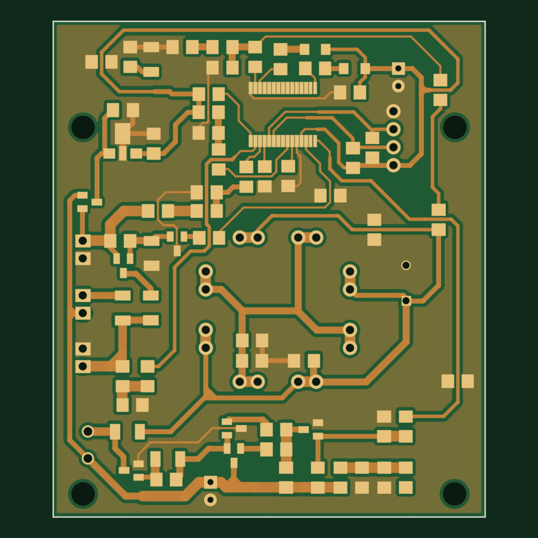
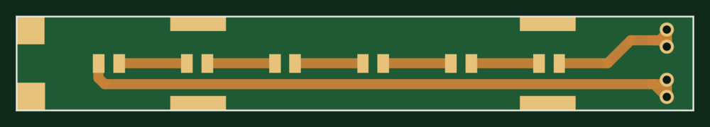

# TRAP — Solar-Powered Pest Trap Controller

A solar battery charger and LED driver for agricultural pest traps, built around a **Renesas RL78/G12** microcontroller with **bare-metal C** firmware. Developed at Shriji Technoaspire in 2022. By day the board charges a Li-ion battery pack from a solar panel; at night it runs from the battery and drives four LED towers that attract insects and light the farm.



*Main board, rev 2.0 — 2-layer, 61 × 70 mm (rendered from the KiCad layout)*

---

## Overview

Small farms need insect control that runs unattended and off-grid. TRAP is a single board that handles the whole day/night cycle on its own:

- **Day:** detects solar input, charges the battery and stops charging when the battery is full.
- **Night:** detects that the solar voltage has dropped and powers the LED towers from the battery.
- **Protection:** cuts the load when the battery runs low and stays off until the sun returns, so the pack is never deep-discharged.

I designed the schematic and PCB in KiCad, wrote the firmware in C, and built an Arduino-based serial programmer to flash the RL78 boards.

## Key specs

| | |
|---|---|
| **MCU** | Renesas RL78/G12 (R5F102AA), 30-pin SSOP |
| **Firmware** | Bare-metal Embedded C, Renesas CS+ / CA78K0R, Code Generator drivers |
| **Power in** | Solar panel |
| **Storage** | Li-ion battery pack, low-battery cutoff at ~7.0 V |
| **Load** | 4 LED towers via JST-EH connectors |
| **Logic supply** | MC78L05 5 V regulator |
| **Main PCB** | 2 layers, 61 × 70 mm, KiCad 6 |
| **Indicators** | CHARGING and LOW BAT status LEDs |

## Hardware

```
Solar panel ──► Schottky / Zener protection ──► Charge switch ──► Li-ion pack
                                                                     │
                     RL78 MCU ◄── ADC: solar & battery dividers ◄────┤
                        │                                            │
                        ├── charge enable / indicator LEDs           ▼
                        └── pulse output ──► LED driver (boost) ──► 4 × LED towers
```

**Main board** (`hardware/main-board/`)
- No KiCad footprint was available for the RL78/G12, so the 30-pin RL78/G13 (R5F100AC) symbol and footprint were used. This is why the schematic and BOM list the G13 part.
- Solar and battery voltages are scaled through resistor dividers into two RL78 ADC channels.
- Charging path uses SS24 Schottky diodes for reverse-current blocking and Zener clamping, with SOT-23 transistors and MOSFETs (AO3400A, TP0610T, BC847) switching the charge and load paths.
- An MC78L05 provides the 5 V logic rail.
- A 4-pin header exposes the programming and debug lines for in-circuit flashing.
- Power traces were widened from a 1.0 mm maximum in rev 1.0 to up to 1.5 mm in rev 2.0, and the ground track was widened for current handling.

**LED tower board** (`hardware/led-board/`)
- A narrow 100 × 14 mm strip of SMD LEDs; four of these form the light towers.



## Firmware

Written in bare-metal C on top of the Renesas Code Generator peripheral drivers (`r_cg_*`). The application logic lives in `r_main.c` and `r_cg_timer_user.c`.

**Sampling (timer interrupt).** Timer TAU0 channel 0 fires periodically. Each interrupt alternates between the solar ADC channel (16) and the battery ADC channel (17), accumulating samples into a moving average: 5 samples for solar, 20 for battery. The longer battery average filters out dips caused by the pulsed LED load.

**Control (main loop state machine).**

| State | Condition | Action |
|---|---|---|
| **Night / LEDs on** | Solar low, battery OK | Pulse the LED driver; switch LEDs off after a fixed on-time to save battery |
| **Charging** | Solar high, battery in range | Enable charging, CHARGING LED on, reset the night timer |
| **Battery full** | Solar high, battery at upper threshold | Stop charging |
| **Low battery** | Solar low, battery below ~7.0 V | Cut the load and latch off until solar returns |

**Flashing.** I built a programmer from an Arduino that flashes the RL78 over its serial interface, so boards could be programmed without a dedicated Renesas emulator.

**Building.** Open `firmware/Final_code.mtpj` in Renesas CS+ (CA78K0R toolchain) and build. The `r_cg_*` files are generated by the Renesas Code Generator; user code sits between the `Start user code` / `End user code` markers.

## Testing and design iterations

The board went through two fabricated revisions, with fixes found during bench and field testing.

**Rev 1.0** (May–June 2022, `hardware/revisions/rev1.0/`): first prototype. Testing found:
- The LED pulse output was routed to the wrong MCU pin.
- A transistor was used where a Schottky barrier diode was needed.
- The A49T Zener was wired in the wrong configuration.
- One indicator LED was missing its supply.

**Rev 2.0** (July 2022, `hardware/main-board/`): final design.
- Pulse output moved from pin 14 to pin 15.
- Transistor replaced with a Schottky barrier diode; symbol and footprint corrected.
- Zener configuration and charging-circuit Zener direction corrected.
- Both indicator LEDs supplied from Vo.
- Unused RST line to the boost circuit removed.
- Track widths increased; track-to-edge clearance reduced to 0.2 mm to fit a wider ground track.

**Firmware tuning** (June 2022):
- Battery averaging increased from 5 to 20 samples to reject low pulses from the LED load.
- The controller entered low-battery mode too early at 7.0 V, so the low-battery threshold was lowered from 265 to 260 ADC counts.

## Repository structure

```
Trap_PCB/
├── hardware/
│   ├── main-board/           KiCad project, rev 2.0 (final)
│   │   ├── bom/              BOM (.csv) and interactive BOM (.html)
│   │   └── fabrication/      Gerbers + drill files (.zip)
│   ├── led-board/            KiCad project for the LED tower strip
│   │   └── fabrication/
│   └── revisions/rev1.0/     First prototype, kept for reference
├── firmware/                 RL78 C source and CS+ project
└── docs/images/              Board renders
```

Open any `.kicad_pro` file in **KiCad 6** or newer. The interactive BOM opens in a browser.

## Tools

KiCad 6 · Renesas CS+ (CA78K0R) · Renesas Code Generator · Arduino · C / Embedded C

---

## Acknowledgements

Thanks to **Dhruvil Patel**, my supervisor at Shriji Technoaspire, for mentoring me through this project and helping develop the firmware.

## License

No license is granted. This repository is shared as a portfolio of my work; all rights reserved.

---

**Smit Vaghela** — Embedded Software / Firmware Engineer · [GitHub](https://github.com/smit2400)
